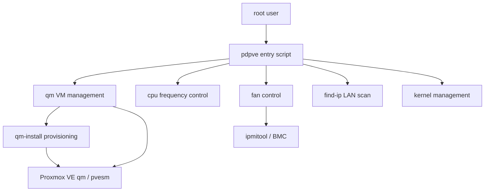

Last updated: 2026-10-25

> [!NOTE]
> This README was generated by [SKILL](https://github.com/agenvoy/skill-readme-generate), get the ZH version from [here](./doc/README.zh.md).

***

<strong>RUN YOUR PROXMOX VE HOST FROM ONE MENU!</strong>

***

> A Bash CLI tool with Proxmox VE VM provisioning, CPU frequency control, and IPMI fan control

## Table of Contents

- [Features](#features)
- [Architecture](#architecture)
- [License](#license)
- [Author](#author)

## Features

> `git clone https://github.com/pardnchiu/pdpve.git && cd pdpve && bash pdpve` · [Documentation](./doc/doc.md)

- **One-Shot Cloud-init VM Provisioning** — Pick a Debian, Rocky Linux, or Ubuntu release and the tool downloads the official cloud image, imports the disk, injects SSH keys, credentials, and network settings, resizes the disk, boots the VM, and destroys any half-built VM when a step fails.
- **Split-Core Frequency Control** — Lock the first N cores to a chosen clock in performance mode while the remaining cores drop to their powersave minimum, with EPYC CPUs skipped automatically.
- **Cross-Vendor IPMI Fan Control** — Detect Dell, Supermicro, HPE, or ASRock Rack through dmidecode and send the matching IPMI raw commands to switch to auto mode or pin a fixed 20-80% speed.
- **LAN Device Discovery** — Ping-sweep the /24 subnet behind vmbr0 in parallel, tag Proxmox, VMware, and QEMU/KVM guests by MAC prefix, and look up the vendor for everything else.
- **Safe Old-Kernel Cleanup** — Purge only the leftover configs of PVE kernel packages in rc state while always excluding the running kernel version.

## Architecture

> [Full Architecture](./doc/architecture.md)

## License

This project is licensed under the [MIT LICENSE](LICENSE).

## Author

Just [open an issue](https://github.com/pardnchiu/pdpve/issues/new) to share an idea.

***

©️ 2025 [邱敬幃 Pardn Chiu](https://www.linkedin.com/in/pardnchiu)
