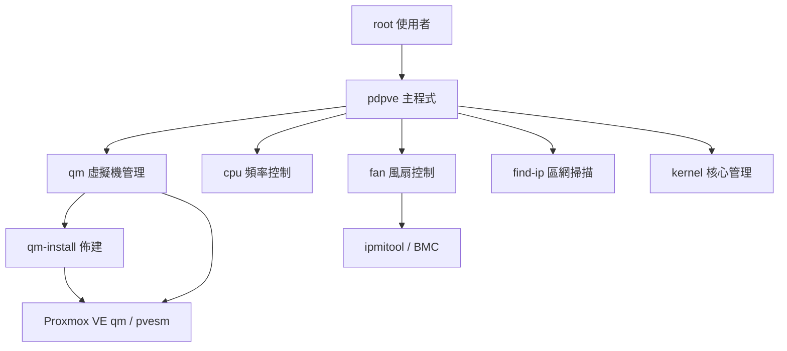

最後更新：2026-10-25

> [!NOTE]
> 此 README 由 [SKILL](https://github.com/agenvoy/skill-readme-generate) 生成，英文版請參閱 [這裡](../README.md)。

***

<strong>RUN YOUR PROXMOX VE HOST FROM ONE MENU!</strong>

***

> Bash 命令列工具，具備 Proxmox VE 虛擬機佈建、CPU 頻率控制與 IPMI 風扇控制

## 目錄

- [功能特點](#功能特點)
- [架構](#架構)
- [授權](#授權)
- [Author](#author)

## 功能特點

> `git clone https://github.com/pardnchiu/pdpve.git && cd pdpve && bash pdpve` · [完整文件](./doc.zh.md)

- **Cloud-init 虛擬機一鍵佈建** — 選定 Debian、Rocky Linux 或 Ubuntu 版本即自動下載官方 Cloud Image（雲端映像檔），完成磁碟匯入、SSH 金鑰、帳密、網路與磁碟擴充後開機，任一步驟失敗即自動清除殘留虛擬機。
- **分段核心頻率控制** — 前 N 個核心以 performance 模式鎖定指定主頻，其餘核心降至 powersave 最低頻率，偵測到 EPYC 時自動跳過。
- **跨品牌 IPMI 風扇調速** — 透過 dmidecode 自動辨識 Dell、Supermicro、HPE、ASRock Rack，送出對應的 IPMI raw 指令切換自動模式或固定 20–80% 轉速。
- **區網裝置掃描與辨識** — 對 vmbr0 所在 /24 網段平行 ping 掃描，依 MAC 前綴標示 Proxmox、VMware、QEMU/KVM 虛擬機，其餘查詢 MAC 廠商。
- **安全的舊核心清理** — 只清除 rc 狀態的 PVE 核心套件殘留設定，並排除當前執行中的核心版本。

## 架構

> [完整架構](./architecture.zh.md)

## 授權

本專案採用 [MIT LICENSE](../LICENSE)。

## Author

Just [open an issue](https://github.com/pardnchiu/pdpve/issues/new) to share an idea.

***

©️ 2025 [邱敬幃 Pardn Chiu](https://www.linkedin.com/in/pardnchiu)
