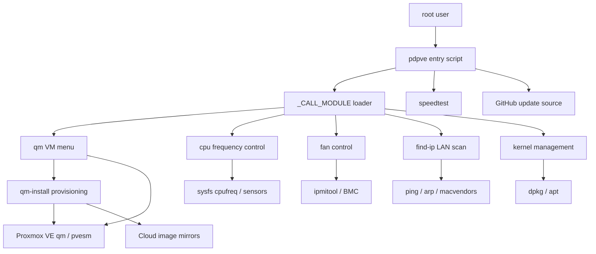
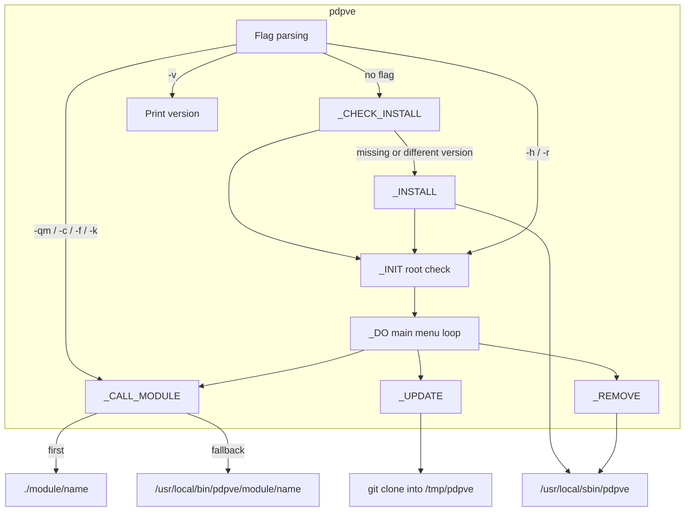
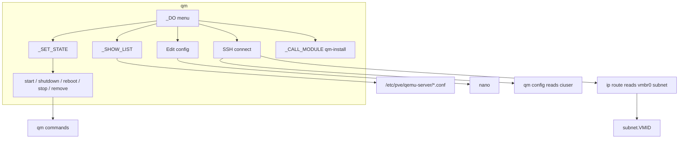
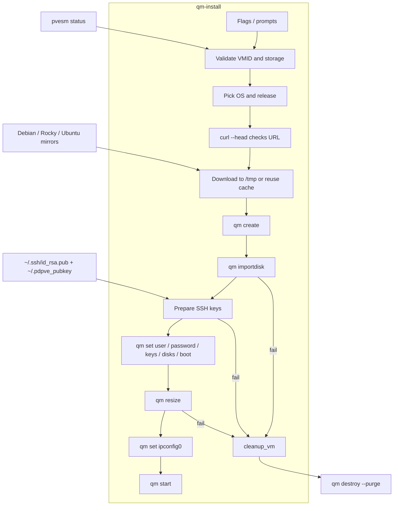
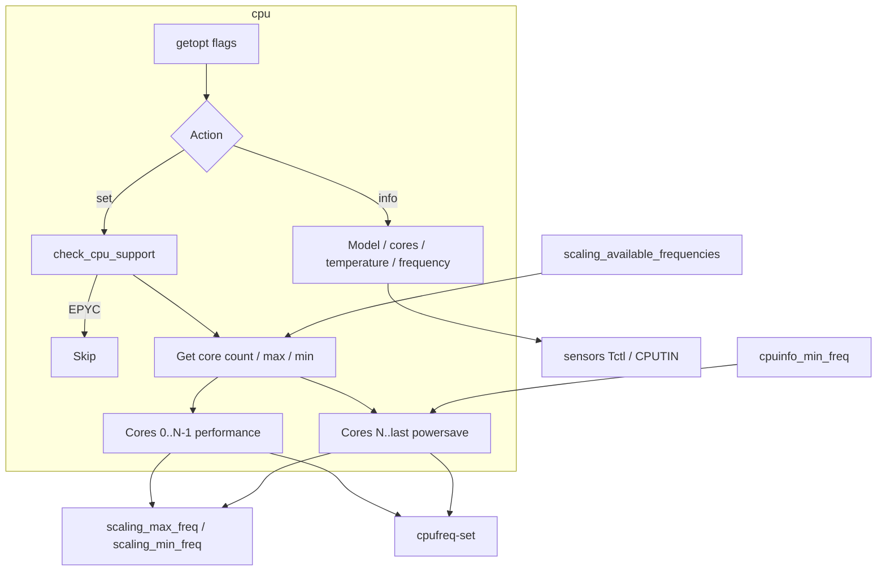
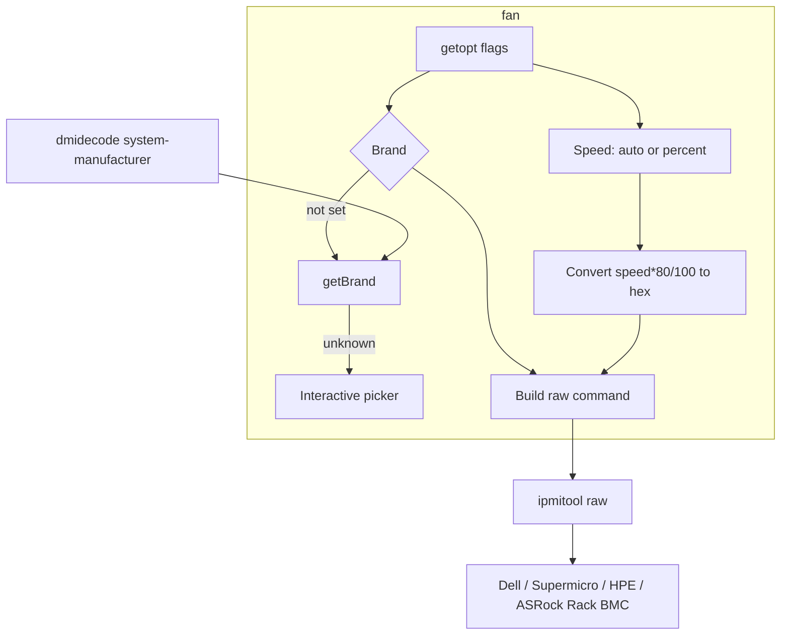
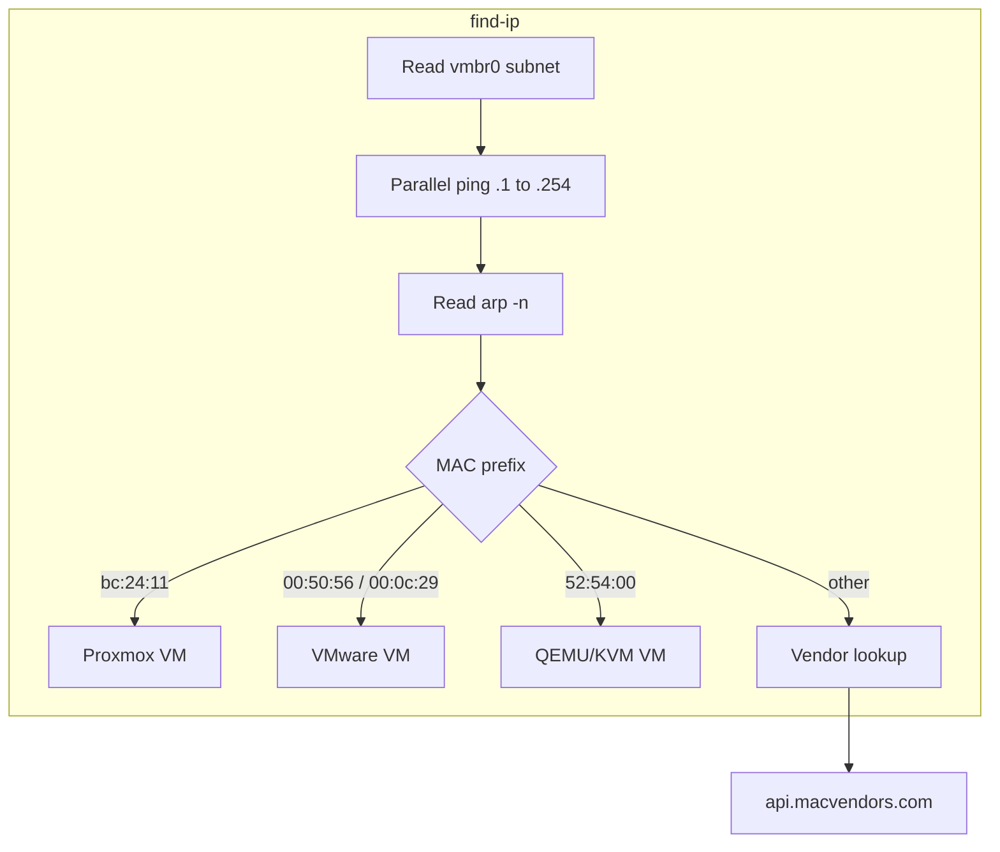
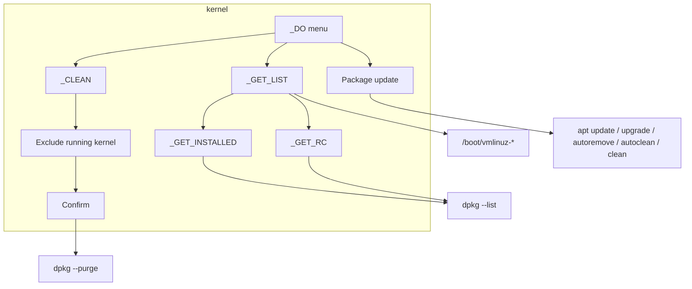
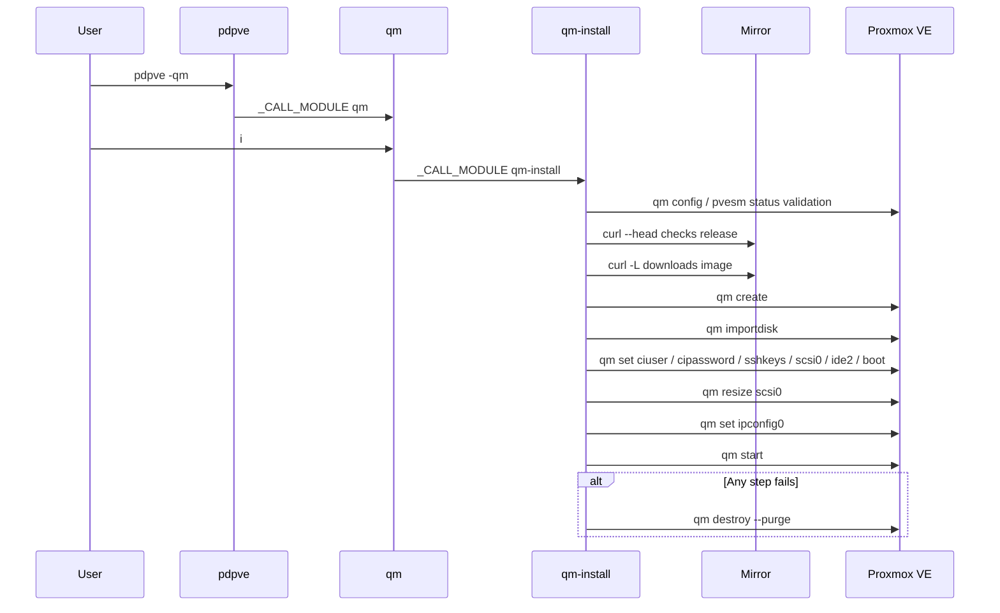
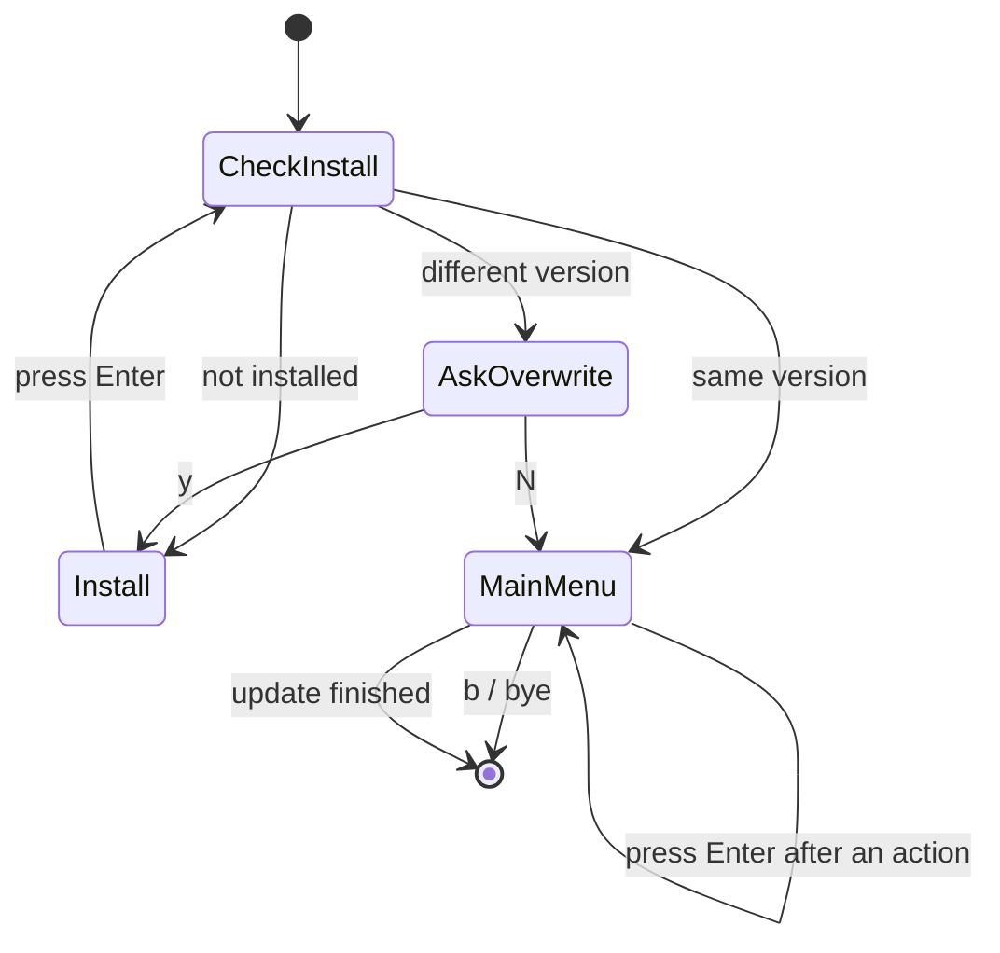

# pdpve - Architecture

Last updated: 2026-10-25

> Back to [README](../README.md)

## Overview

## Module: pdpve Entry Script

Parses flags or shows the interactive main menu, installs, updates, and removes itself, and dispatches work to the modules.

## Module: qm

VM menu that wraps `qm` commands and provides SSH access with an IP derived from the VMID.

## Module: qm-install

Creates a VM from a cloud image and cleans up on failure.

## Module: cpu

Splits cores into performance and powersave groups with frequency limits, and reports CPU info.

## Module: fan

Detects the server brand and sends the matching IPMI raw commands.

## Module: find-ip

Scans the /24 subnet behind `vmbr0` and identifies devices.

## Module: kernel

Lists, updates, and cleans PVE kernel packages.

## Data Flow

Interaction sequence when creating a VM:

## State Machine

Installation check when the entry script starts without flags:

***

©️ 2025 [邱敬幃 Pardn Chiu](https://www.linkedin.com/in/pardnchiu)
