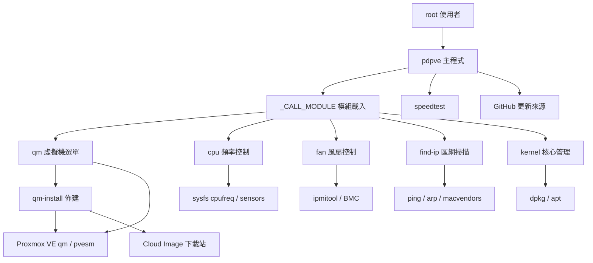
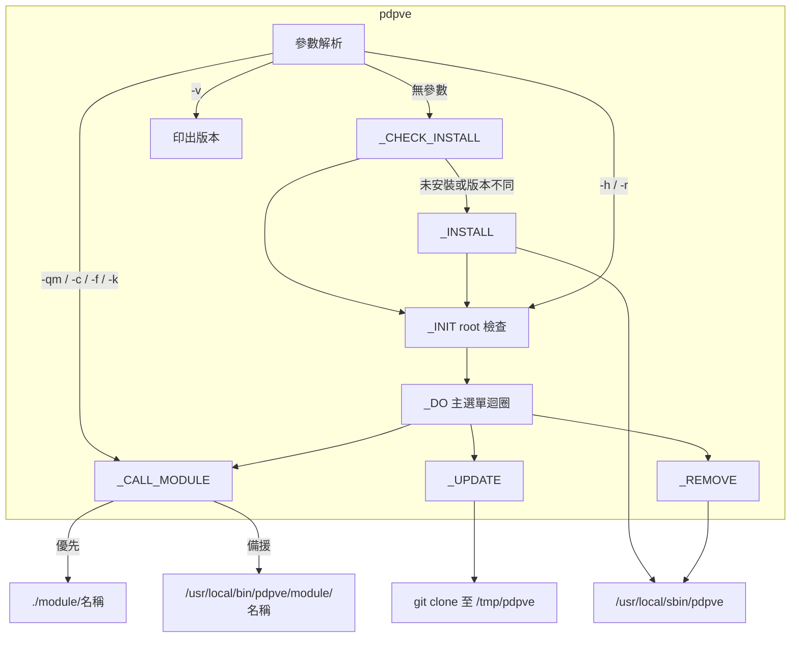
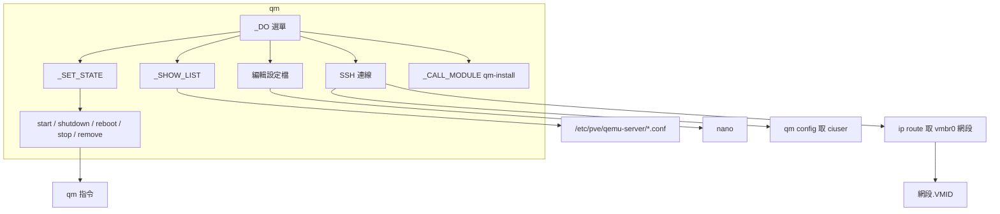
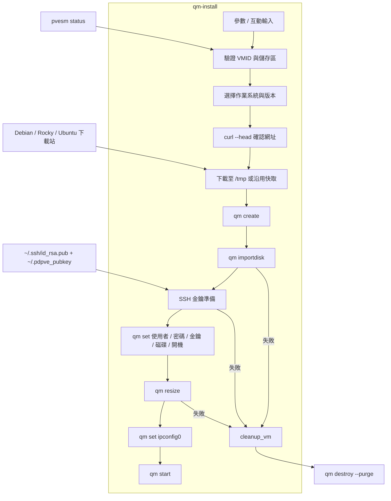
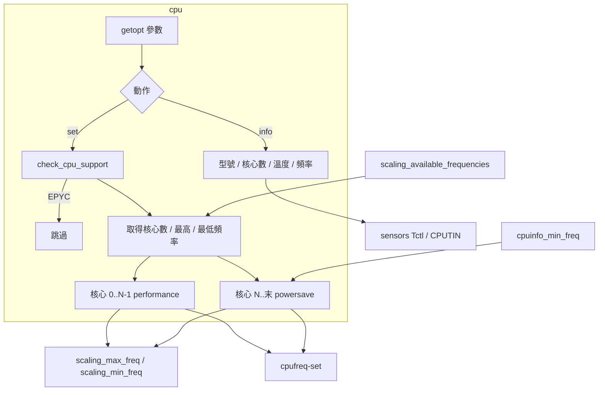
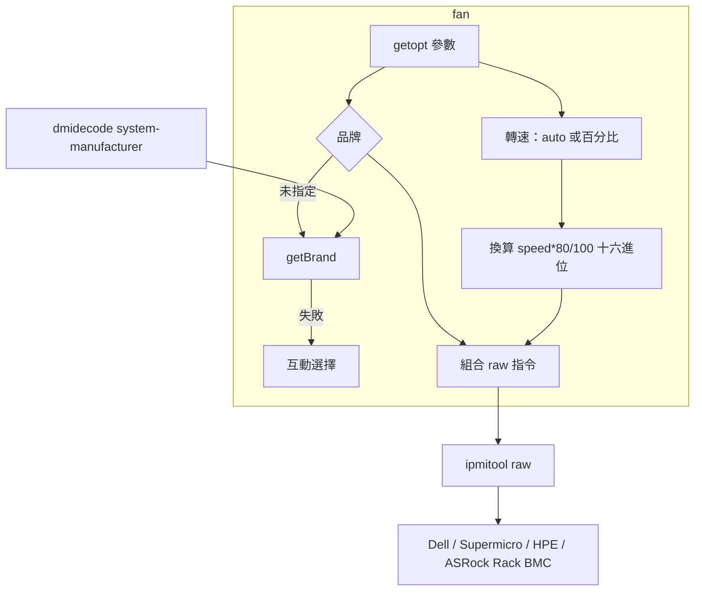
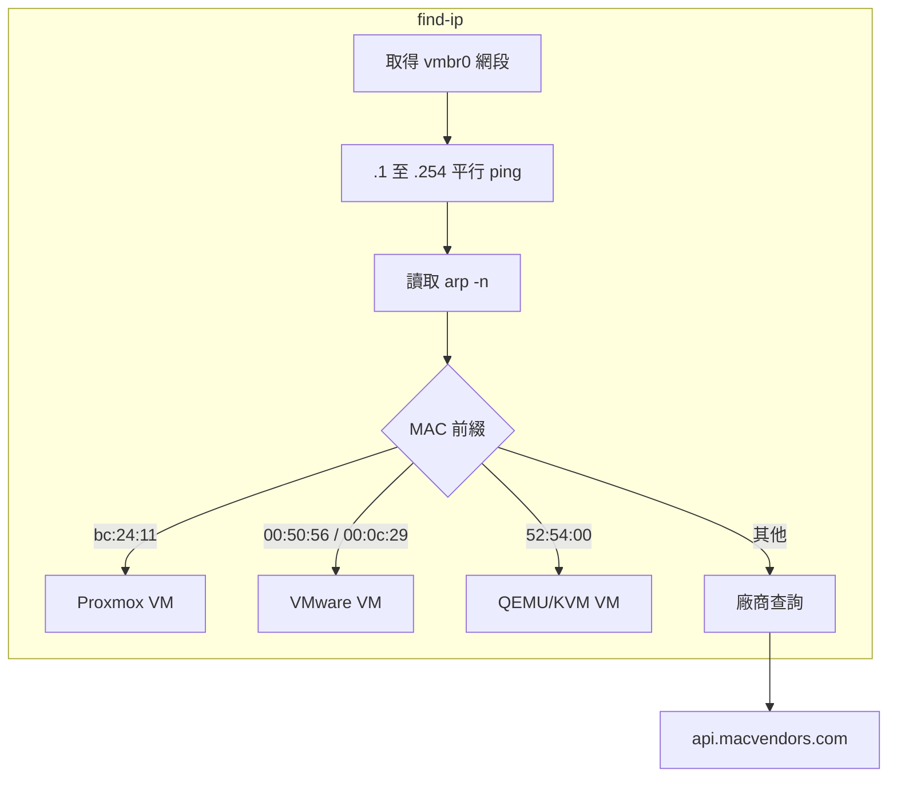
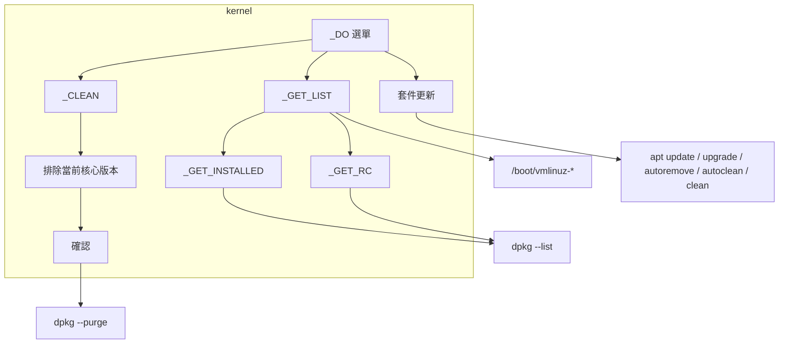
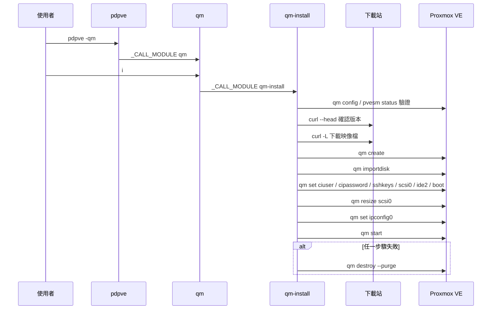
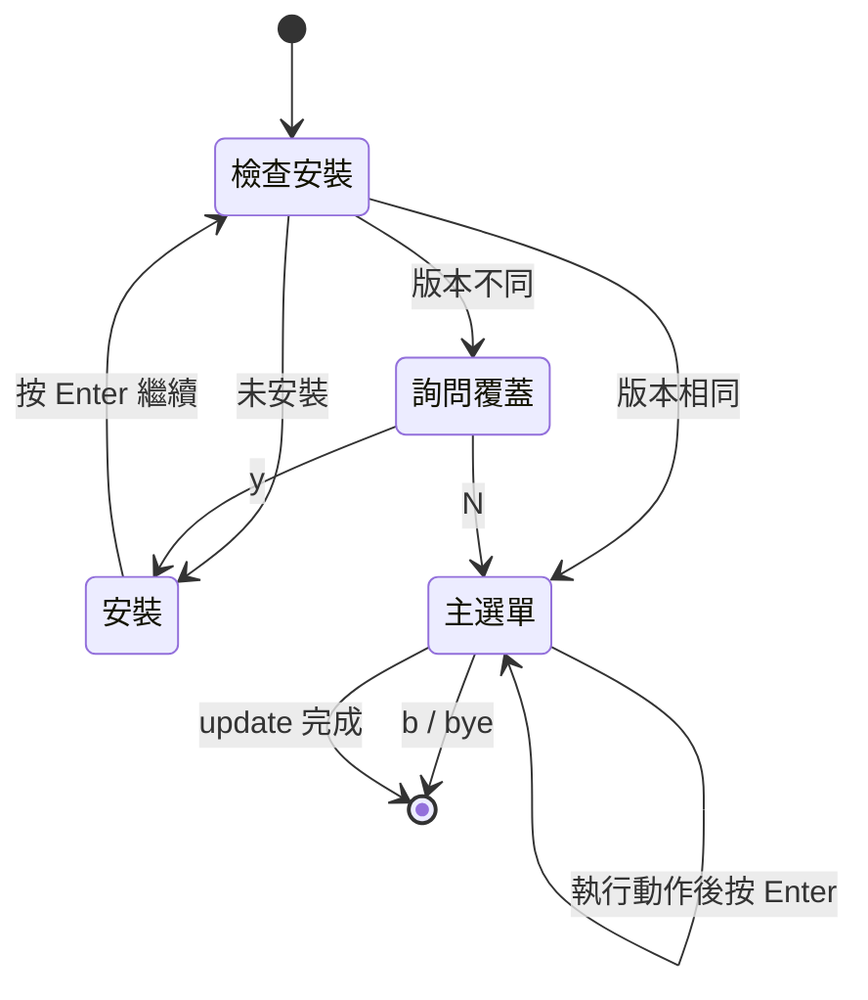

# pdpve - 架構

最後更新：2026-10-25

> 返回 [README](./README.zh.md)

## 概覽

## Module: pdpve 主程式

解析參數或顯示互動主選單，安裝、更新、移除自身，並把工作分派給各模組。

## Module: qm

虛擬機選單，包裝 `qm` 指令並提供以 VMID 推算 IP 的 SSH 連線。

## Module: qm-install

以 Cloud Image 建立虛擬機，失敗時清除殘留。

## Module: cpu

依核心數分段設定 governor 與頻率上下限，並提供 CPU 資訊。

## Module: fan

偵測伺服器品牌並送出對應的 IPMI raw 指令。

## Module: find-ip

掃描 `vmbr0` 所在 /24 網段並辨識裝置。

## Module: kernel

列出、更新與清理 PVE 核心套件。

## 資料流

建立虛擬機時的互動序列：

## 狀態機

主程式無參數啟動時的安裝檢查：

***

©️ 2025 [邱敬幃 Pardn Chiu](https://www.linkedin.com/in/pardnchiu)
